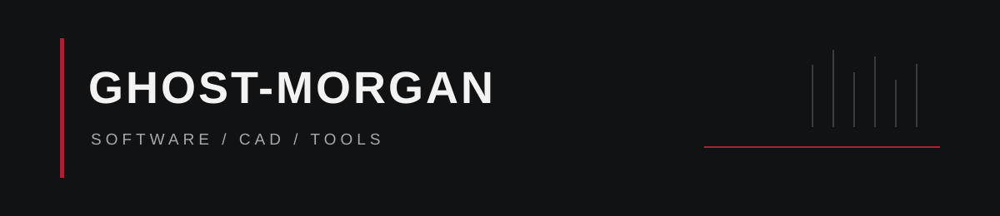

  

## Profile

I build practical software, CAD workflows, and small tools with a focus on precision, clarity, and dependable behavior.

## Selected work

### CAD and drafting

- [QuickLook CAD Preview](https://github.com/Ghost-Morgan/QuickLook-CAD-Preview) - interactive DWG and DXF previews for Windows.
- [LAP - Locate Alignment Point](https://github.com/Ghost-Morgan/AutoLISP-LAP-Alignment-Profile) - locate Civil 3D alignment stations in profile views.
- [LPP - Locate Profile Point](https://github.com/Ghost-Morgan/AutoLISP-LPP-Profile-Plan) - map profile-view stations back to plan.

### Tools

- [PowerToys RunAcrylic](https://github.com/Ghost-Morgan/PowerToys-RunAcrylic) - tray controls for PowerToys Run appearance and an on-demand plugin keyword list.
- [Browse AutoLISP commands](https://github.com/Ghost-Morgan?tab=repositories&q=AutoLISP) - compact commands for color, polylines, and construction lines.

## Interests

Software engineering, CAD automation, desktop tooling, and thoughtful interface details.

---

  Precision over noise.

